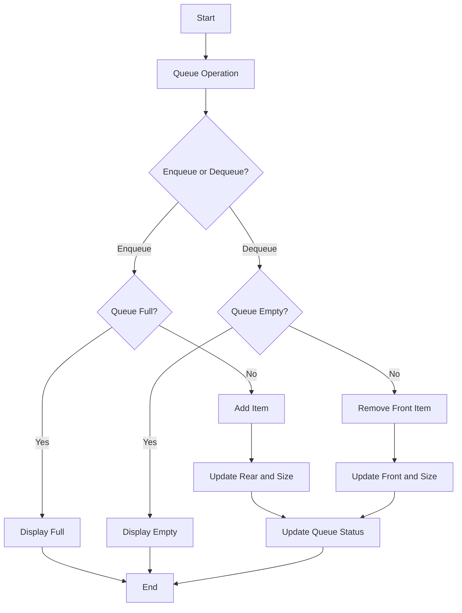

# STC89C52 Educational Microcontroller Simulator - Week 3

## Objective
Enhance the Week 2 simulator with Memory, Stack, and FIFO Queue functionality and integrate these components with the CPU.

## Week 3 Components
- **Memory:** 256-byte read/write memory with 8-bit values.
- **Stack:** Stack Pointer starts at 07H; supports PUSH and POP.
- **FIFO Queue:** Circular queue with Enqueue, Dequeue, empty/full checks.
- **CPU Integration:** CPU exposes Memory, Stack and Queue and supports PUSH, POP, ENQUEUE and DEQUEUE.
- **Testing:** Separate tests for CPU, Memory, Stack, Queue and integration.
- **Assembly Validation:** `assembly/QueueValidation.asm` demonstrates the expected FIFO validation sequence.

## Project Structure
```text
STC89C52_Week3/
├── src/
│   ├── CPU.java
│   ├── Instruction.java
│   ├── Main.java
│   ├── Memory.java
│   ├── Stack.java
│   └── FIFOQueue.java
├── test/
│   ├── CPU_Test.java
│   ├── Memory_Test.java
│   ├── Stack_Test.java
│   ├── Queue_Test.java
│   └── Integration_Test.java
└── assembly/
    └── QueueValidation.asm
```

## Compile and Run
From the project folder:

```bash
mkdir out
javac -d out src/*.java test/*.java
java -cp out CPU_Test
java -cp out Memory_Test
java -cp out Stack_Test
java -cp out Queue_Test
java -cp out Integration_Test
java -cp out Main
```

## Queue Flowchart


## Expected FIFO Result
```text
Enqueue: 10, 20, 30
Dequeue: 10, 20, 30
FIFO RESULT: PASS
```
