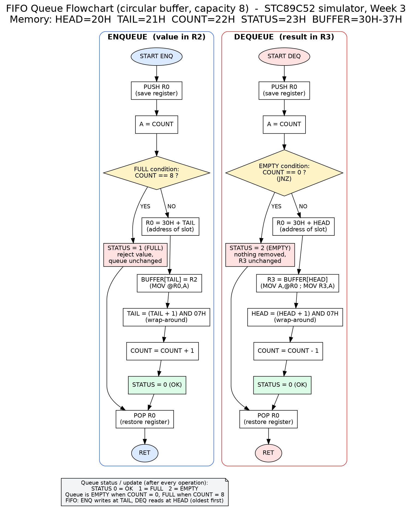

# STC89C52 Simulator - Week 3 Test Document

All results below were produced by `./run_all.sh` (or `run_all.bat`) and are saved in `out/test-results-week3.txt`
and `out/queue-execution-results.txt`.

## Summary

| Suite | Test program | Cases | Passed | Failed |
|---|---|---|---|---|
| Week 2 regression (CPU) | `test/CPU_Test.java` | 9 | 9 | 0 |
| New instructions (CPU role) | `test/InstructionTest.java` | 42 | 42 | 0 |
| Memory | `test/MemoryTest.java` | 22 | 22 | 0 |
| Stack | `test/StackTest.java` | 20 | 20 | 0 |
| FIFO Queue (Java) | `test/QueueTest.java` | 16 | 16 | 0 |
| Queue assembly validation | `test/QueueAsmTest.java` | 3 + 30 table checks | all | 0 |

## 1. Memory test cases

| ID | Test case | Result |
|---|---|---|
| M1 | power-up: all 256 cells are 0 | PASS |
| M2 | write then read back 0x5A at 30H | PASS |
| M3 | boundary addresses 00H and FFH | PASS |
| M4 | values are truncated to 8 bits (1FFH -> FFH) | PASS |
| M5 | negative value stored as 8-bit (-1 -> FFH) | PASS |
| M6 | overwrite replaces old value | PASS |
| M7 | neighbouring cells unaffected | PASS |
| M8 | read at 100H is rejected  [Memory address out of range: 0x100 (valid 0x00-0xFF)] | PASS |
| M9 | write at -1 is rejected  [Memory address out of range: 0xFFFFFFFF (valid 0x00-0xFF)] | PASS |
| M10 | clear() zeroes memory | PASS |
| M11 | access counters (2 writes, 3 reads) | PASS |
| M12 | last read/write address tracked | PASS |
| M13 | peek/poke do not change counters | PASS |
| M14 | dump() shows hex row | PASS |
| M15 | CPU direct write: MOV 30H,#55H | PASS |
| M16 | CPU direct read:  MOV A,30H | PASS |
| M17 | CPU indirect write: MOV @R0,A | PASS |
| M18 | CPU indirect read:  MOV B,@R1 | PASS |
| M19 | R3 is stored at address 03H | PASS |
| M20 | writing address 05H changes R5 | PASS |
| M21 | indirect access to top of RAM (FFH) | PASS |
| M22 | memory loop: fill 40H-47H with 0..7 | PASS |

## 2. Stack test cases

| ID | Test case | Result |
|---|---|---|
| S1 | SP = 07H after reset | PASS |
| S2 | stack empty after reset | PASS |
| S3 | PUSH increments SP (07H -> 08H) | PASS |
| S4 | PUSH stores value at [SP] | PASS |
| S5 | three pushes -> depth 3, SP=0AH | PASS |
| S6 | stack contents bottom->top = 1,2,3 | PASS |
| S7 | LIFO: pops return 3,2,1 | PASS |
| S8 | SP back to 07H after popping all | PASS |
| S9 | PUSH/POP with direct addresses | PASS |
| S10 | swap A and B using the stack | PASS |
| S11 | POP on empty stack -> underflow  [Stack underflow: stack is empty (SP=0x07)] | PASS |
| S12 | overflow: 249th PUSH exceeds FFH  [Stack overflow: SP=0xFF] | PASS |
| S13 | 248 pushes fill stack exactly to SP=FFH | PASS |
| S14 | ACALL/RET runs subroutine and returns | PASS |
| S15 | SP restored after RET | PASS |
| S16 | return address uses 2 stack bytes (SP=09H inside call) | PASS |
| S17 | nested calls: depth 4 inside INNER (SP=0BH) | PASS |
| S18 | back in OUTER depth 2 (SP=09H), final SP=07H | PASS |
| S19 | RET with empty stack -> underflow  [Stack underflow: stack is empty (SP=0x07)] | PASS |
| S20 | PUSH/POP saves and restores a register | PASS |

## 3. FIFO queue test cases (Java model)

| ID | Test case | Result |
|---|---|---|
| Q1 | new queue is empty | PASS |
| Q2 | dequeue on empty returns -1, status EMPTY | PASS |
| Q3 | 3 enqueues -> size 3, status OK | PASS |
| Q4 | FIFO order preserved in toList() | PASS |
| Q5 | dequeue returns oldest first (10,20,30) | PASS |
| Q6 | empty again after removing all | PASS |
| Q7 | 8 enqueues fill the queue | PASS |
| Q8 | enqueue on full is rejected, status FULL | PASS |
| Q9 | rejected value not stored; queue unchanged | PASS |
| Q10 | wrap-around: tail wraps to index 2 | PASS |
| Q11 | order kept across wrap-around | PASS |
| Q12 | value stored in buffer slot 0 (30H) | PASS |
| Q13 | memory layout: BUF[0]=55H HEAD=0 TAIL=1 COUNT=1 | PASS |
| Q14 | interleaved enqueue/dequeue | PASS |
| Q15 | 5000 random operations match java.util.ArrayDeque | PASS |
| Q16 | attach() does not modify an existing queue | PASS |

## 4. New CPU instruction test cases

| ID | Test case | Result |
|---|---|---|
| I1 | MOV A,Rn | PASS |
| I2 | MOV direct,direct | PASS |
| I3 | MOV DPTR,#16-bit | PASS |
| I4 | INC DPTR wraps to 0000H | PASS |
| I5 | MOV to immediate rejected  [Cannot write to an immediate value: #5] | PASS |
| I6 | @R2 rejected (only @R0/@R1)  [Indirect addressing only allowed with @R0 or @R1, got: @R2] | PASS |
| I7 | INC direct wraps FFH -> 00H | PASS |
| I8 | INC/DEC @R0 | PASS |
| I9 | DEC A wraps 00H -> FFH | PASS |
| I10 | ADD A,direct | PASS |
| I11 | SUBB A,@R0 | PASS |
| I12 | ANL then XRL | PASS |
| I13 | ORL direct,#imm | PASS |
| I14 | CPL A (AAH -> 55H) | PASS |
| I15 | CLR A | PASS |
| I16 | SETB C | PASS |
| I17 | CLR C | PASS |
| I18 | CPL C | PASS |
| I19 | NOP changes nothing | PASS |
| I20 | P=1 after MOV A,#07H (3 ones) | PASS |
| I21 | P=0 after MOV A,#03H (2 ones) | PASS |
| I22 | JZ taken when A=0 | PASS |
| I23 | JZ not taken when A!=0 | PASS |
| I24 | JNZ taken when A!=0 | PASS |
| I25 | JC taken after carry | PASS |
| I26 | JNC taken when no carry | PASS |
| I27 | CJNE equal -> not taken, CY=0 | PASS |
| I28 | CJNE A<imm -> taken, CY=1 | PASS |
| I29 | CJNE A>imm -> taken, CY=0 | PASS |
| I30 | CJNE Rn,#imm | PASS |
| I31 | DJNZ loop runs 5 times (A=10, R2=0) | PASS |
| I32 | DJNZ direct (3 iterations) | PASS |
| I33 | DJNZ with 0 wraps to FFH (256 iterations) | PASS |
| I34 | SJMP to label skips code | PASS |
| I35 | LJMP to label | PASS |
| I36 | HALT stops execution | PASS |
| I37 | unknown mnemonic rejected  [Assembly error, line 1: Unknown mnemonic: FOO] | PASS |
| I38 | undefined label rejected  [Assembly error, line 1: Undefined label: NOWHERE] | PASS |
| I39 | wrong operand count rejected  [Assembly error, line 1: MOV expects 2 operand(s), found 1] | PASS |
| I40 | infinite loop caught by cycle limit  [Cycle limit reached - possible infinite loop] | PASS |
| I41 | EQU constants (#VAL, DATA) | PASS |
| I42 | Instruction.toString() prints SJMP operand | PASS |

## 5. Queue flowchart

See `docs/queue_flowchart.png` (source `queue_flowchart.dot`, vector `queue_flowchart.svg`).
It shows ENQUEUE and DEQUEUE, the FULL (COUNT = 8) and EMPTY (COUNT = 0) decisions, and the
status/update steps (HEAD/TAIL wrap-around, COUNT, STATUS).



## 6. Assembly validation program

Program: `programs/queue_test.asm` (82 instructions). Scenario and what it proves:

| Step | Action | Expected |
|---|---|---|
| 1 | Enqueue 11H, 22H, 33H, 44H, 55H | COUNT = 5 |
| 2 | Dequeue 3 values | 11H, 22H, 33H out (FIFO order); COUNT = 2 |
| 3 | Enqueue 66H, 77H, 88H, 99H, 0AAH, 0BBH | COUNT = 8 (FULL); TAIL wraps around the buffer |
| 4 | Enqueue 0CCH on a full queue | Rejected, STATUS = 1, value never stored |
| 5 | Dequeue 8 values | 44H, 55H, 66H, 77H, 88H, 99H, 0AAH, 0BBH; COUNT = 0 |
| 6 | Dequeue on an empty queue | STATUS = 2 |

Two independent reference models give the *expected* values: `java.util.ArrayDeque` (pure FIFO behaviour)
and the Java `FifoQueue` class (identical circular-buffer layout, compared byte for byte).

## 7. Execution results (expected vs actual)

Run: `java -cp out Main` - 82 instructions assembled, 482 instructions executed, CPU halted normally.

```
CHECK                                        EXPECTED   ACTUAL     RESULT
-----------------------------------------------------------------------------------
Dequeue #1 value (FIFO order) @40H           11H        11H        PASS
Dequeue #2 value (FIFO order) @41H           22H        22H        PASS
Dequeue #3 value (FIFO order) @42H           33H        33H        PASS
Dequeue #4 value (FIFO order) @43H           44H        44H        PASS
Dequeue #5 value (FIFO order) @44H           55H        55H        PASS
Dequeue #6 value (FIFO order) @45H           66H        66H        PASS
Dequeue #7 value (FIFO order) @46H           77H        77H        PASS
Dequeue #8 value (FIFO order) @47H           88H        88H        PASS
Dequeue #9 value (FIFO order) @48H           99H        99H        PASS
Dequeue #10 value (FIFO order) @49H          AAH        AAH        PASS
Dequeue #11 value (FIFO order) @4AH          BBH        BBH        PASS
COUNT after 5 enqueues                       05H        05H        PASS
COUNT after 3 dequeues                       02H        02H        PASS
COUNT after 6 more enqueues (full)           08H        08H        PASS
COUNT after 8 dequeues (empty)               00H        00H        PASS
STATUS: enqueue on FULL queue (1=FULL)       01H        01H        PASS
STATUS: dequeue on EMPTY queue (2=EMPTY)     02H        02H        PASS
Rejected value 0CCH never entered queue      00H        00H        PASS
Final HEAD index (wrap-around)               03H        03H        PASS
Final TAIL index (wrap-around)               03H        03H        PASS
Final COUNT                                  00H        00H        PASS
Buffer slot 0 @30H                           99H        99H        PASS
Buffer slot 1 @31H                           AAH        AAH        PASS
Buffer slot 2 @32H                           BBH        BBH        PASS
Buffer slot 3 @33H                           44H        44H        PASS
Buffer slot 4 @34H                           55H        55H        PASS
Buffer slot 5 @35H                           66H        66H        PASS
Buffer slot 6 @36H                           77H        77H        PASS
Buffer slot 7 @37H                           88H        88H        PASS
Stack empty after program (SP = 07H)         07H        07H        PASS
-----------------------------------------------------------------------------------
Total checks: 30   Passed: 30   Failed: 0
```

Final machine state: SP = 07H (stack balanced), HEAD = TAIL = 3, COUNT = 0, output area `40H-4AH` =
`11 22 33 44 55 66 77 88 99 AA BB`.

### Test case listing for the assembly validation program

| ID | Test case | Result |
|---|---|---|
| A1 | program assembled (82 instructions) | PASS |
| A2 | program halted normally | PASS |
| A3 | all expected-vs-actual checks pass | PASS |

